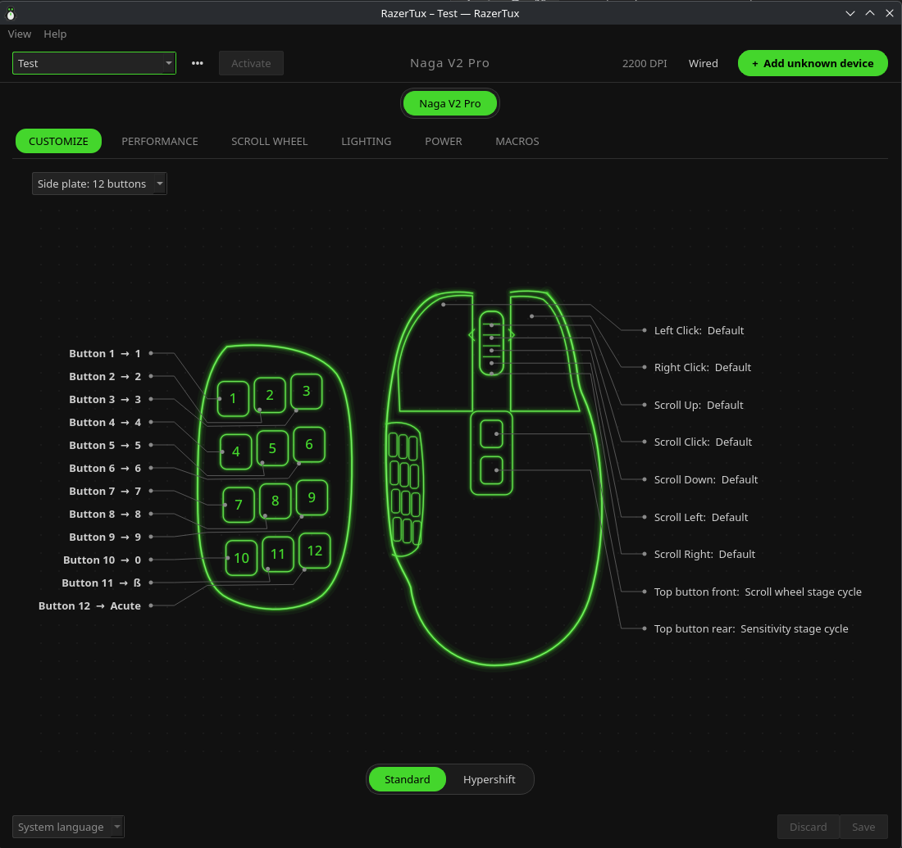
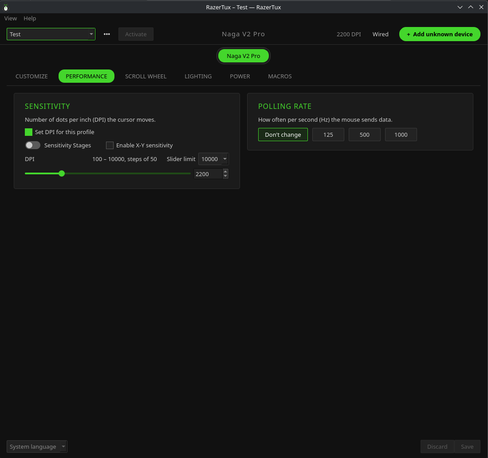
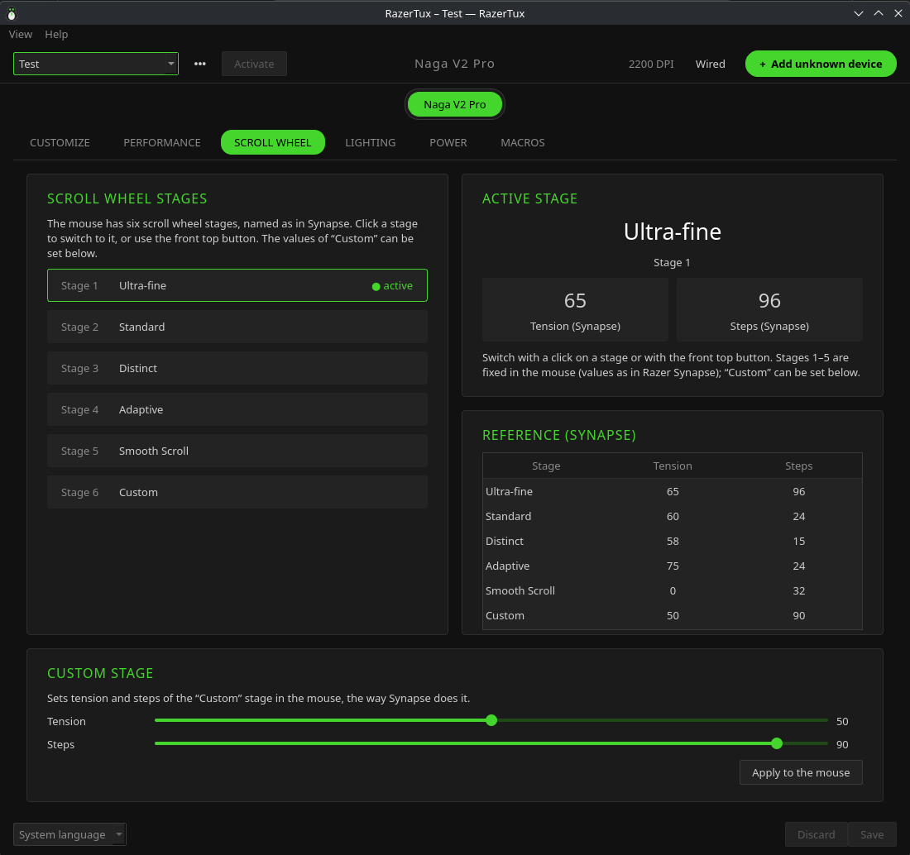
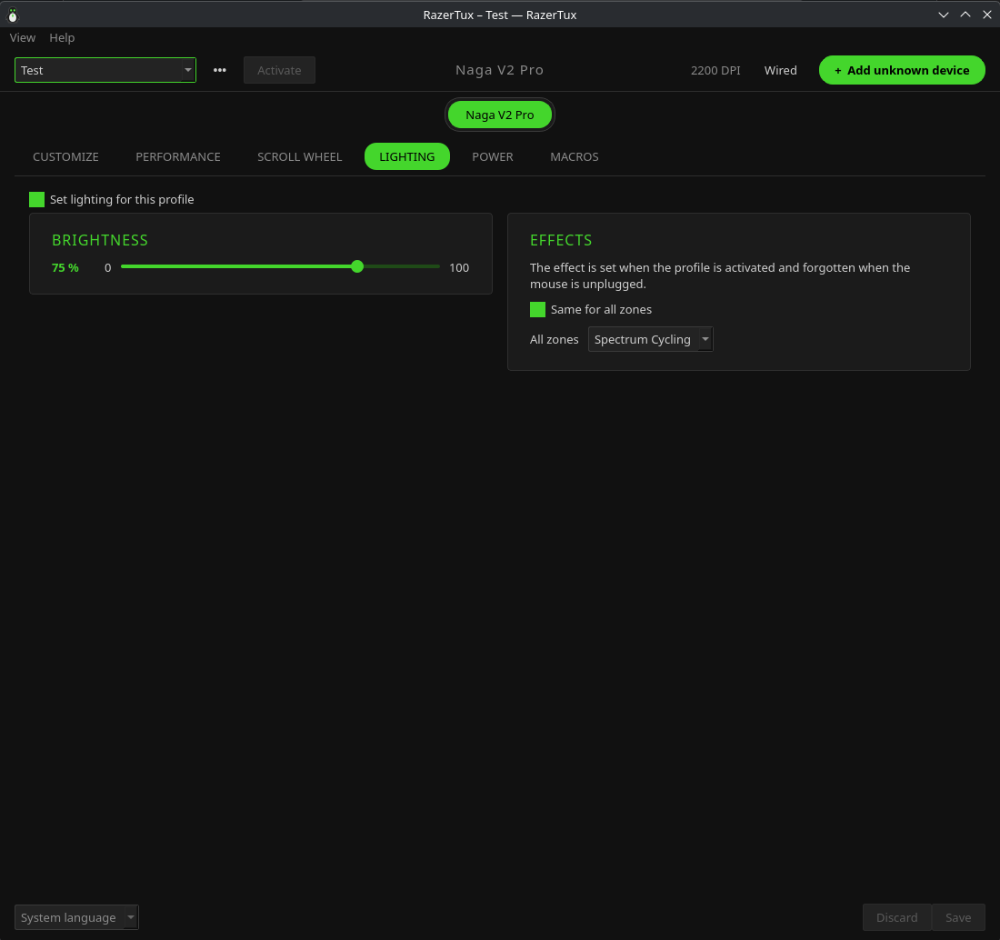
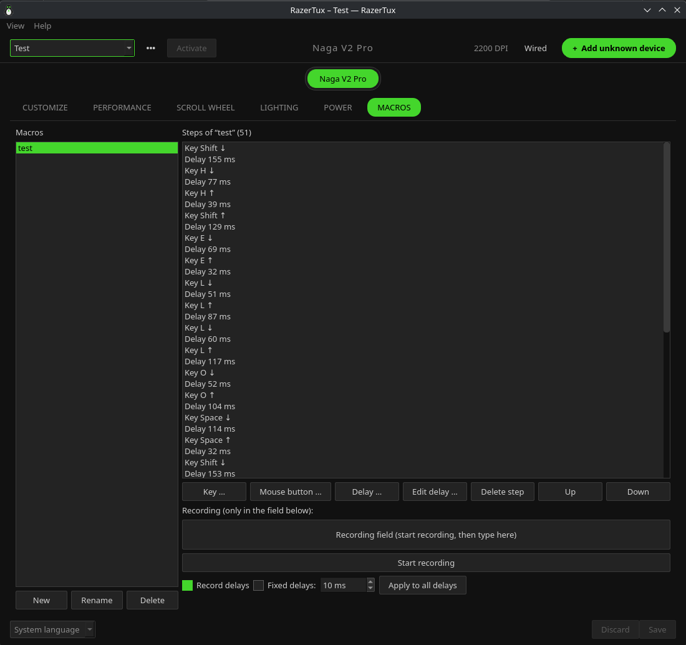

# RazerTux

**An unofficial Linux replacement for Razer Synapse**: buttons, macros, profiles, DPI,
lighting and battery for Razer mice, with a tray icon. English, German, Spanish and French.

> **Not an official Razer product; not affiliated with Razer Inc.** "Razer" and "Naga" are
> trademarks of Razer Inc.; RazerTux uses no Razer logos.
> Project: <https://github.com/anoraknophobia/RazerTux>
>
> **Work in progress – vibe coded.** A hobby project, written almost entirely by an AI coding
> assistant (Claude Code) under the direction of its maintainer. It has an automated test
> suite, but no line-by-line human review. Expect bugs; use it at your own risk.



<details>
<summary>More screenshots</summary>

<table>
  <tr>
    <td><br>
      <sub>Performance: DPI and polling rate</sub></td>
    <td><br>
      <sub>Scroll wheel: stages and the Custom stage</sub></td>
  </tr>
  <tr>
    <td><br>
      <sub>Lighting: brightness and effects</sub></td>
    <td><br>
      <sub>Macros: record and edit</sub></td>
  </tr>
</table>

</details>

## Installation

Open a terminal and run, as your normal user (not with `sudo`):

```
curl -fsSL https://raw.githubusercontent.com/anoraknophobia/RazerTux/main/install.sh | bash
```

Then unplug the mouse, plug it in again and open **RazerTux** from the application menu.

- **Update:** run the same command again.
- **Uninstall:** the same command with `bash -s -- --uninstall` at the end. It offers to
  restore the mouse's original settings first; your profiles stay in `~/.config/razertux`.

| Distribution | Status |
|---|---|
| Arch, CachyOS, EndeavourOS, Manjaro | tested with a real mouse |
| Debian 13+, Ubuntu 24.04+, Linux Mint 22+ | installer tested in a container |
| Fedora, openSUSE Tumbleweed | installer tested in a container |
| Debian 12, Ubuntu 22.04, openSUSE Leap 15 | not supported (Python older than 3.11) |
| Distributions without systemd | not supported |

Tried it on a distribution that is not tested yet? Please tell us how it went in an
[issue](https://github.com/anoraknophobia/RazerTux/issues).

<details>
<summary>Install from the source, manual install on Arch, what gets installed</summary>

**From the source** (if you want to read the script first): `git clone` this repository or
download `Source code (tar.gz)` from
[Releases](https://github.com/anoraknophobia/RazerTux/releases), then run `./install.sh` in
that folder (`./install.sh --uninstall` removes it again).

**Manual install on Arch:**

```
cd packaging
makepkg -si
systemctl --user enable --now razertuxd.service
```

Build dependencies: `python-build`, `python-installer`, `python-wheel`, `python-setuptools`.

**What gets installed:** on Arch a pacman package. Elsewhere the dependencies come from the
distribution's package manager, RazerTux itself goes into `/opt/razertux` (Python modules
the distribution lacks come from PyPI; the system Python is not touched). Both install a
udev rule, a systemd user service (`razertuxd`), a D-Bus service file, the menu entry, the
tray autostart, the icon and the recorder's polkit helper. Outside Arch the list is kept in
`/opt/razertux/installed-files`.

After updating some other way, restart the service:
`systemctl --user restart razertuxd.service`.

</details>

## Supported devices

| Device | Status |
|---|---|
| Razer Naga V2 Pro (dongle and USB) | verified, full feature set |
| 88 other Razer mice (OpenRazer database) | experimental: untested, no guarantee |
| 107 Razer keyboards (OpenRazer database) | recognised only, not configurable yet |

On experimental mice RazerTux first only reads and backs up the device state before
anything is written; which settings are available depends on the model. Keyboards appear
with a picture of their size; RazerTux never reads what you type.

## Your mouse or keyboard is missing?

Is your Razer device missing, or are some of its buttons not recognized? The built-in
recorder collects a small, anonymous device report that you can send to the project. This
is the way to get your device supported.

1. Click **"Add unknown device"** at the top right (or Help → "Record device…"), or run
   `razertux-record`.
2. Choose your device.
3. Entering your password is optional; it only unlocks extra read-only information.
4. Press the buttons of the device, one after another.
5. Optionally run the light test.
6. Review the report and submit it on GitHub (you need a GitHub account).

**Privacy:** the report contains no serial numbers, no user or host names and no paths.
Only the distinct button signals are recorded, never typed text. Nothing is saved on the
device; the light test uses NOSTORE only and disappears on its own.

**Something does not work on a supported device?** Choose **"Copy diagnostics"** in the app
and paste the text into an [issue](https://github.com/anoraknophobia/RazerTux/issues).

<details>
<summary>For maintainers</summary>

`tools/import_device_report.py` reads a submitted device report and turns it into entries
for the device database.

</details>

## Features

- **Buttons:** assignments, key combinations, macros, Hypershift, several profiles per model.
  The Naga's top buttons are freely assignable (default: scroll stage and DPI stage).
- **Learn button:** teach RazerTux a button it does not recognise by pressing it.
- **Performance:** DPI, DPI stages and polling rate.
- **Scroll wheel** (Naga V2 Pro): stage by click (Ultra-fine … Custom), tension and steps of
  the Custom stage.
- **Lighting** for logo and thumb pad, **battery** level, idle time and low-battery warning.
- **Several mice at once**, each with its own profiles.
- **On-screen display** when the profile or DPI stage changes (toggle in the tray menu).
- Razer-style dark look or system colours (*View → Use system colors*); language under
  *View → Language*.

## Usage

On first connect the service backs up the mouse's original state automatically to
`~/.config/razertux/mouse-backup.json` (an existing backup is never overwritten). Then
create a profile in the app; switch profiles from the tray.

Command line:

- `razertux status`: mouse state compared with the backup
- `razertux restore`: write the backed-up state back (also in the tray: "Restore original
  state"). Covers DPI, DPI stages, polling rate, brightness and power settings; effects and
  colours reset themselves when the mouse is replugged.
- `razertux backup`: create the backup by hand (optional, only needed without a running
  service; it does not overwrite anything either).

All accept `--model` when several mice are connected.

## RazerTux and OpenRazer

RazerTux needs no kernel module and does not need
[OpenRazer](https://github.com/openrazer/openrazer), but works with it. Choose under
**View → Device access**:

- **RazerTux** (default): RazerTux talks to the mouse itself and sets lighting, DPI and
  polling rate temporarily; the mouse's own values come back when RazerTux stops.
- **RazerTux + OpenRazer** (only while the OpenRazer daemon runs): everything OpenRazer
  offers for the mouse (lighting, polling rate, battery, power, DPI) goes through OpenRazer,
  so tools like Polychromatic and RazerTux do not fight. Buttons, macros, profiles and the
  Naga's scroll-wheel stages always stay with RazerTux.

## Known limits

- Bluetooth: normal input only, no configuration. Use the wireless dongle or USB.
- Scroll wheel: only the "Custom" stage can be changed; stages 1–5 are fixed in the mouse.
- `kill -9` on the service skips the cleanup; until systemd restarts it, the Naga's top
  buttons do not react (replugging the mouse helps).
- `dbus-next` is deprecated as of Python 3.15; a replacement will be needed then.
- More hardware details: `docs/hardware-notes.md`.

## Contributing

Translations are JSON files in `razertux/i18n/<lang>.json`
(`{"context": {"English text": "translation"}}`); `tests/test_i18n.py` checks that every text
is translated. Changes per version:
[Releases](https://github.com/anoraknophobia/RazerTux/releases) or `CHANGELOG.md`.

## Credits and license

Much of the knowledge about the HID protocol of Razer mice, and the device database, comes
from [OpenRazer](https://github.com/openrazer/openrazer) (GPL-2.0), see `OPENRAZER-NOTICE`.
Many thanks to the OpenRazer project. The mouse drawings with button labels and the app icon
(penguin) are original drawings; no Razer images or logos are used.

RazerTux is free software under the GNU General Public License, version 2 or (at your option)
any later version (GPL-2.0-or-later). See `LICENSE`.
