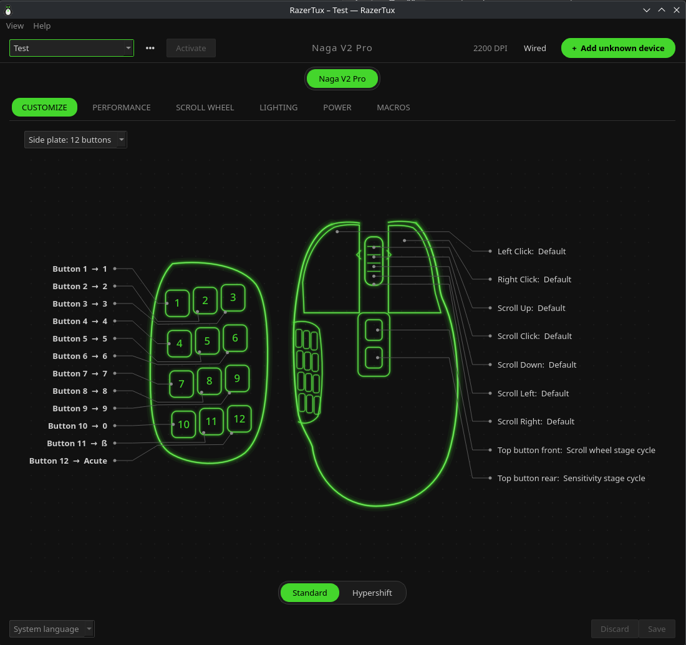
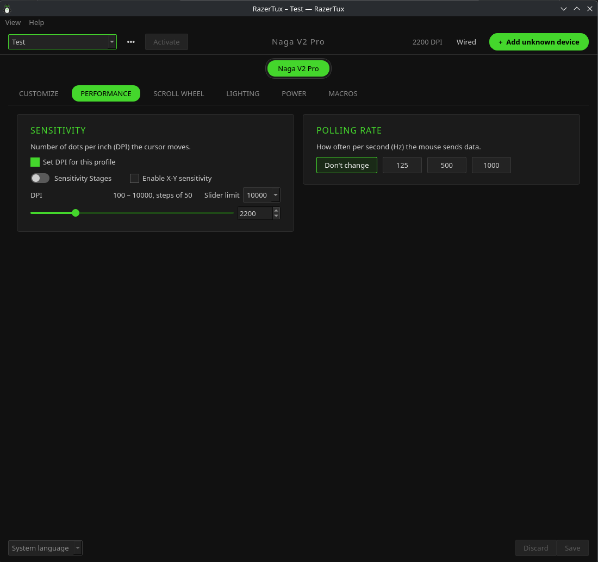
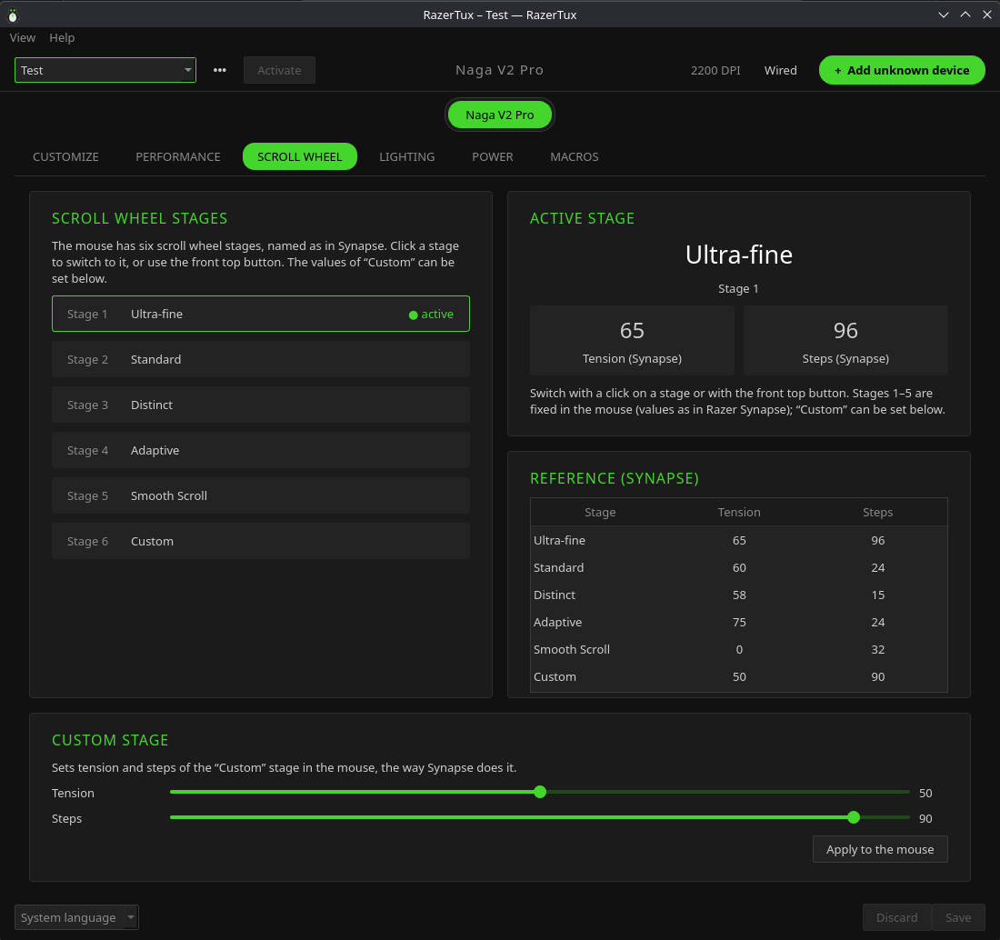
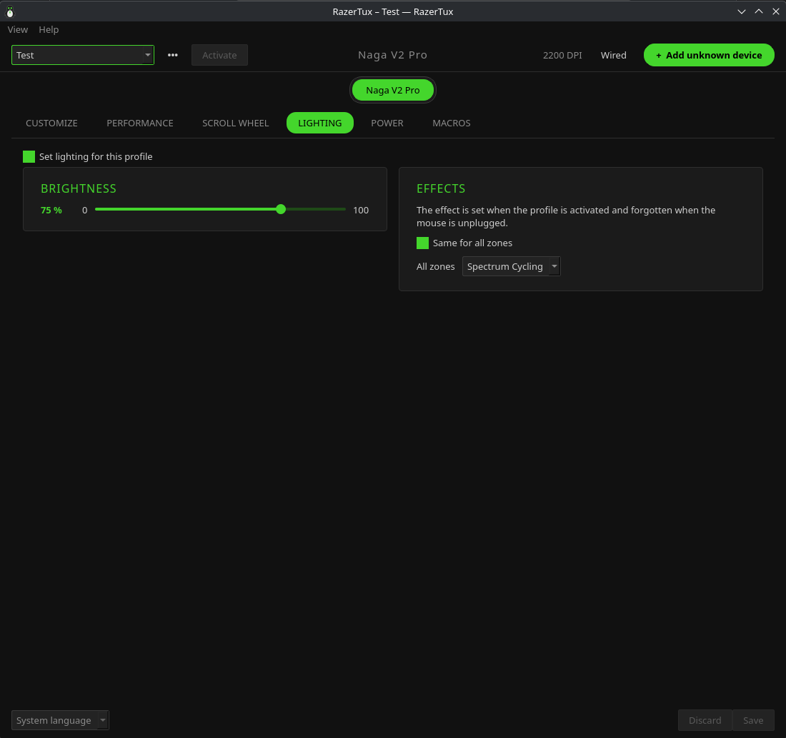
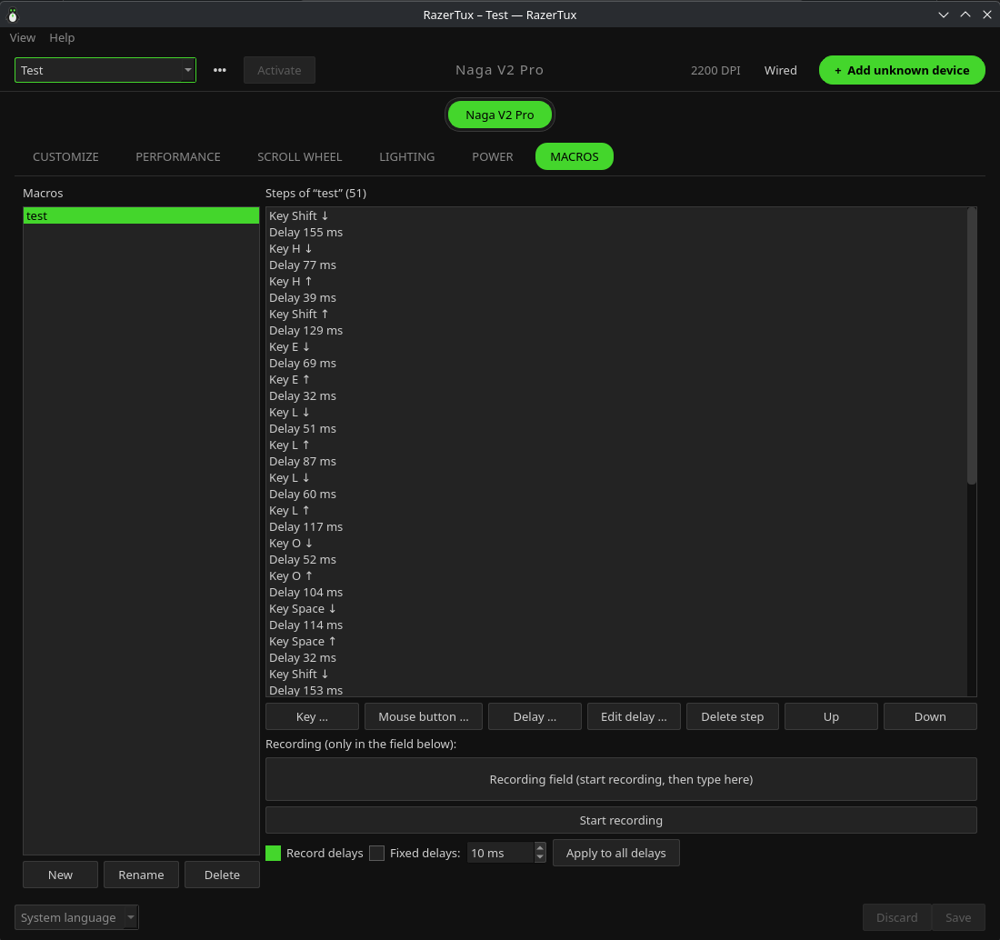

# RazerTux

> **Not an official Razer product; not affiliated with Razer Inc.**
> "Razer" and "Naga" are trademarks of Razer Inc.; RazerTux uses no Razer logos.
>
> Project: <https://github.com/anoraknophobia/RazerTux>

> **Work in progress – vibe coded.** RazerTux is a hobby project and still under
> development; expect bugs and changes. It was written almost entirely by an AI coding
> assistant (Claude Code) under the direction of its maintainer, not by an experienced
> developer ("vibe coding"). It has an automated test suite, but the code has not been
> reviewed line by line by a human. Use it at your own risk.

RazerTux is an unofficial Linux replacement for Razer Synapse. It supports the Razer Naga V2
Pro and, experimentally, other Razer mice; Razer keyboards are recognised but not configured
yet (tested on CachyOS/Arch, KDE Plasma Wayland). It consists of a background service
(`razertuxd`), a command line tool (`razertux`) and a Qt GUI with a tray icon
(`razertux-gui`). The GUI is available in English, German, Spanish and French.



<table>
  <tr>
    <td><br>
      <sub>Performance: DPI and polling rate</sub></td>
    <td><br>
      <sub>Scroll wheel: stages and the Custom stage</sub></td>
  </tr>
  <tr>
    <td><br>
      <sub>Lighting: brightness and effects</sub></td>
    <td><br>
      <sub>Macros: record and edit</sub></td>
  </tr>
</table>

## Features

- **Buttons**: assignments, key combinations, macros, Hypershift, several profiles per model.
- **Top buttons** (Naga V2 Pro): freely assignable. By default the front one steps the
  scroll wheel stage and the rear one the DPI stage, as under Synapse.
- **Learn button**: teach RazerTux the signal of a button it does not recognise (press it on the
  mouse) and assign it to a button slot. Needs the running service.
- **Performance**: DPI, DPI stages and polling rate. A DPI value written permanently is
  restored to the backed-up value when the service exits cleanly.
- **Scroll wheel** (Naga V2 Pro): choose the stage by click (Ultra-fine … Custom) and set
  tension and steps of the "Custom" stage.
- **Lighting**: brightness and effects for logo and thumb pad (the scroll wheel has no LED).
- **Power/battery**: charge level, idle time, low-battery warning.
- **Multi-device**: several mice at once, each with its own per-model profiles.
- **Keyboards** (untested): connected Razer keyboards are recognised and can be recorded.
- **Add unknown device**: a recorder for Razer devices RazerTux does not support yet (see
  "Help add your device").
- **On-screen display** when the profile or DPI stage changes (toggle in the tray menu).
- Razer-style dark look or the system colours (*View → Use system colors*).
- UI languages: English, German, Spanish and French.

## Installation

RazerTux needs Linux with systemd, Python 3.11 or newer and a desktop session (KDE Plasma,
GNOME, … on Wayland or X11). OpenRazer is optional: see
[RazerTux and OpenRazer](#razertux-and-openrazer).

### Quick install (all distributions)

1. Download the source: either `git clone https://github.com/anoraknophobia/RazerTux.git`, or
   the `Source code (tar.gz)` of the newest version under
   [Releases](https://github.com/anoraknophobia/RazerTux/releases), then unpack it.
2. Open a terminal in that folder and run, as your normal user (not with `sudo`):

   ```
   ./install.sh
   ```

   The script asks for your password when it needs administrator rights.
3. Unplug the mouse and plug it in again, then open RazerTux from the application menu. The
   tray icon starts automatically from your next login on.

What `install.sh` does depends on the distribution. Only Arch (CachyOS) has been tested so
far; the other distributions are **untested (work in progress)**. If you try one of them,
please report how it went in an [issue](https://github.com/anoraknophobia/RazerTux/issues).

- **Arch Linux, CachyOS, EndeavourOS, Manjaro** (tested): builds the pacman package from
  `packaging/PKGBUILD` and installs it with pacman.
- **Debian 13+, Ubuntu 24.04+, Linux Mint 22+** (untested): installs the dependencies with
  `apt` and RazerTux into `/opt/razertux`.
- **Fedora** (untested): installs the dependencies with `dnf` and RazerTux into `/opt/razertux`.
- **openSUSE Tumbleweed** (untested): installs the dependencies with `zypper` and RazerTux
  into `/opt/razertux`.
- **Other distributions** (untested): installs RazerTux into `/opt/razertux`. Install
  Python 3.11+ with `venv`, polkit and, where packaged, python-evdev, pyudev, dbus-next and
  PySide6 first.

Outside Arch, Python modules your distribution does not package (for example PySide6 on older
releases) are downloaded from PyPI into `/opt/razertux`; nothing is installed into the system
Python. Besides `/opt/razertux` the script installs the same files as the Arch package: the
udev rule (`/etc/udev/rules.d/70-razertux.rules`), the user service
(`/etc/systemd/user/razertuxd.service`), the D-Bus service file, the menu entry, the tray
autostart (`/etc/xdg/autostart/razertux-tray.desktop`), the icon, the commands in
`/usr/local/bin` and the recorder's polkit helper. The list is kept in
`/opt/razertux/installed-files`.

Older releases (Debian 12, Ubuntu 22.04, openSUSE Leap 15) ship Python older than 3.11 and
are not supported. Distributions without systemd are not supported either (you can still start
`razertuxd` yourself).

### Manual install on Arch

```
cd packaging
makepkg -si
systemctl --user enable --now razertuxd.service
```

Build dependencies (`makedepends`): `python-build`, `python-installer`, `python-wheel`,
`python-setuptools`.

The service starts with the graphical session (`graphical-session.target`) and is also
started on demand via D-Bus (`io.github.razertux`). If you copied a udev rule to
`/etc/udev/rules.d/` by hand earlier, please remove it; the package installs
`70-razertux.rules` to `/usr/lib/udev/rules.d/`.

## Upgrading

Download the new version and run `./install.sh` again (on Arch you can also run
`makepkg -si` in `packaging/`). The script restarts the service and the tray. If you
upgraded another way, restart them yourself or log out and back in:

```
systemctl --user restart razertuxd.service
```

What changed in each version: see [Releases](https://github.com/anoraknophobia/RazerTux/releases)
or `CHANGELOG.md`.

## Getting started

1. Connect the mouse via wireless dongle or USB and start `razertux-gui` (or click the tray
   icon). On first connect the service automatically backs up the mouse's initial state to
   `~/.config/razertux/mouse-backup.json` (an existing backup is never overwritten).
2. Create a profile and set buttons, DPI and lighting. You can switch profiles in the tray.

Command line: `razertux status` shows the mouse state and `razertux restore` restores the
backed-up state. `razertux backup` creates the backup by hand (optional, only needed without
a running service; it does not overwrite anything either). All three accept `--model` to
pick a model when several mice are connected.

## Help add your device

Is your Razer device missing, or are some of its buttons not recognized? The built-in
recorder collects a small, anonymous device report that you can send to the project.

1. Click **"Add unknown device"** at the top right (or Help → "Record device…"), or run
   `razertux-record`.
2. Choose your device.
3. Entering your password is optional; it only unlocks extra read-only information.
4. Press the buttons of the device, one after another.
5. Optionally run the light test.
6. Review the report and submit it on GitHub (you need a GitHub account).

Privacy promise: the report contains no serial numbers, no user or host names and no
paths. Only the distinct button signals are recorded, never typed text. Nothing is
persisted on the device, and the light test uses NOSTORE only (it is not saved to the
device and disappears on its own).

### For maintainers

`tools/import_device_report.py` reads a submitted device report and turns it into entries
for the device database.

## Language

*View → Language* (also in the tray menu): system language, English, German, Spanish,
French. "System language" uses the language of the system and falls back to English if it
is not supported. The GUI switches to a new language after a restart ("Restart now" restarts
it immediately); the service switches immediately (battery warning, configuration errors).
The setting is stored as `"language"` in `~/.config/razertux/settings.json`.

English is the source language. Translations are JSON files in `razertux/i18n/<lang>.json`
(`{"context": {"English text": "translation"}}`); `tests/test_i18n.py` checks that every
text is translated and the placeholders match.

## Restoring the original state

```
razertux restore
```

(or "Restore original state" in the tray) writes the backed-up values back: DPI, DPI stages,
polling rate, brightness and the power settings (idle time, low-battery threshold). Effects
and colors are not included; the mouse resets them itself when unplugged and plugged in
again. Use `razertux status` to compare the result against the backup. The backup is stored
in `~/.config/razertux/mouse-backup.json`.

## Uninstalling

In the RazerTux source folder:

```
./install.sh --uninstall
```

It first offers to restore the mouse's original settings from the backup, then stops the
service and removes RazerTux (on Arch with `pacman -Rns razertux`, elsewhere everything the
installer put on the system). Your profiles and the mouse backup stay in
`~/.config/razertux`; delete that folder to remove them too:

```
rm -r ~/.config/razertux
```

By hand on Arch:

```
razertux restore
systemctl --user disable --now razertuxd.service
sudo pacman -Rns razertux
```

Run `razertux restore` before uninstalling, while RazerTux is still installed.

## RazerTux and OpenRazer

RazerTux does not need [OpenRazer](https://github.com/openrazer/openrazer), but works with
it. Choose under **View → Device access**:

- **RazerTux** (default): RazerTux talks to the mouse itself. No kernel module needed.
  Lighting, DPI and polling rate are set temporarily and the mouse's own values are written
  back when RazerTux stops. This also works with OpenRazer installed, as long as no other
  tool (e.g. Polychromatic) changes the same settings.
- **RazerTux + OpenRazer**: whatever the OpenRazer daemon offers for your mouse (lighting
  zones, polling rate, battery, power settings, DPI) goes through OpenRazer, so tools like
  Polychromatic and RazerTux do not fight. OpenRazer stores these values in the mouse
  permanently. Empty fields in a RazerTux profile leave OpenRazer's settings alone.
  Button remapping, macros, profiles and the Naga's scroll-wheel stages always stay with
  RazerTux. On the Naga V2 Pro the DPI stages and the thumb grid lighting also stay with
  RazerTux. If the OpenRazer daemon stops, RazerTux takes over until it is back.

The option is only selectable while the OpenRazer daemon is running
(`systemctl --user status openrazer-daemon`).

## Supported mice

- **Razer Naga V2 Pro**: verified (wireless dongle and USB), full feature set.
- **All other Razer mice from the OpenRazer database** (88 models / 117 USB product IDs, see
  `razertux/devices/openrazer_mice.json`): **experimental**. RazerTux first only reads (read
  probe) and backs up the device state before anything is written. On these mice, DPI,
  polling rate and similar settings are available depending on the model; these mice are
  untested, so there is no guarantee.
- Reporting problems: choose **"Copy diagnostics"** in the GUI and paste the text into a
  GitHub issue (<https://github.com/anoraknophobia/RazerTux/issues>).
- The database comes from OpenRazer (GPL-2.0), see `OPENRAZER-NOTICE` (installed to
  `/usr/share/licenses/razertux/`). The udev rule `70-razertux.rules` is generated from it
  with `python tools/import_openrazer.py --udev`.

## Keyboards (untested)

Razer keyboards from the OpenRazer database (107 models) are recognised: a connected one
appears in the device bar with a picture of a typical keyboard of its size (full size,
tenkeyless, 75 % or 60 %, guessed from the model name) and a button **"Record this keyboard
…"**. RazerTux cannot configure keyboards yet and has not been tested with one. It never
reads what you type: there is no key assignment for keyboards, and the device recorder only
keeps which special keys exist (ordinary typing keys are counted, never stored). Recording
your keyboard is the way to get it supported.

## Laser graphics

The mouse views with button labels ("laser" lines) are original drawings (SVG templates in
the package). No Razer images or logos are used.

## On-screen display (OSD)

When the profile or the DPI stage changes, RazerTux briefly shows a confirmation on screen.
The display can be switched on and off in the tray menu.

## Known limits

- Bluetooth: normal input only, no configuration. Use the wireless dongle or USB.
- Scroll-wheel stage values: only the "Custom" stage can be changed (stages 1–5 are fixed in
  the mouse).
- `kill -9` on the service skips the cleanup. systemd restarts the service; until then
  the Naga's top buttons do not react. Without a running service, unplugging and
  replugging the mouse helps.
- `dbus-next` is deprecated as of Python 3.15; a replacement will be needed then.
- More hardware details: `docs/hardware-notes.md`.

## Credits

Much of the knowledge about the HID protocol of Razer mice, and the device data, comes from
[OpenRazer](https://github.com/openrazer/openrazer) (GPL-2.0). Many thanks to the OpenRazer
project. The app icon (penguin) is an original drawing.

## License

This program is free software; you can redistribute it and/or modify it under
the terms of the GNU General Public License as published by the Free Software
Foundation; either version 2 of the License, or (at your option) any later
version (GPL-2.0-or-later). See `LICENSE` for the GPL-2.0 text.
